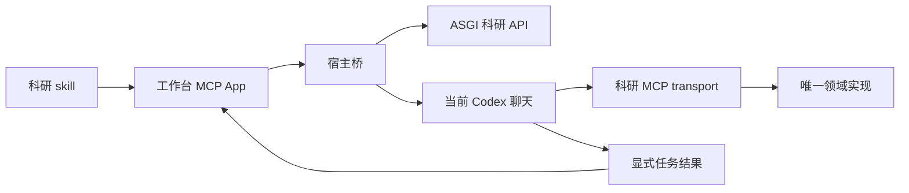

# MambaResearch Kernel 架构

更新：2026-10-09。Codex App 是模型执行和聊天宿主。MambaResearch 提供一个科研 skill、MCP App 和四个科研领域 MCP。

Kernel 从 profile/catalog 注册 HTTP 和 MCP capabilities，拥有装配与逆序生命周期。科研 plugin 拥有 domain provider；core.http 拥有平台 API 和记录数据库；core.workbench 拥有工作台入口。UI 由本地编译 contributions、Capability Provider 与 AppRuntime 装配。

原生聊天内容由 Codex App 管理。工作台数据库保存研究资产、旧历史和显式任务结果；v9 migration 将旧 session 关联改为归档，保留旧值并删除其运行时语义。任务上下文显式固定，科研产物写在所选项目 outputs 中。

详细合同见[实施索引](../技术实施文档/00-实施文档索引.md)。一个能力只有一个 owner 和生产路径；同批删除被替换的代码、测试、配置和 live 文档。实际验收未完成时维持实施中。
